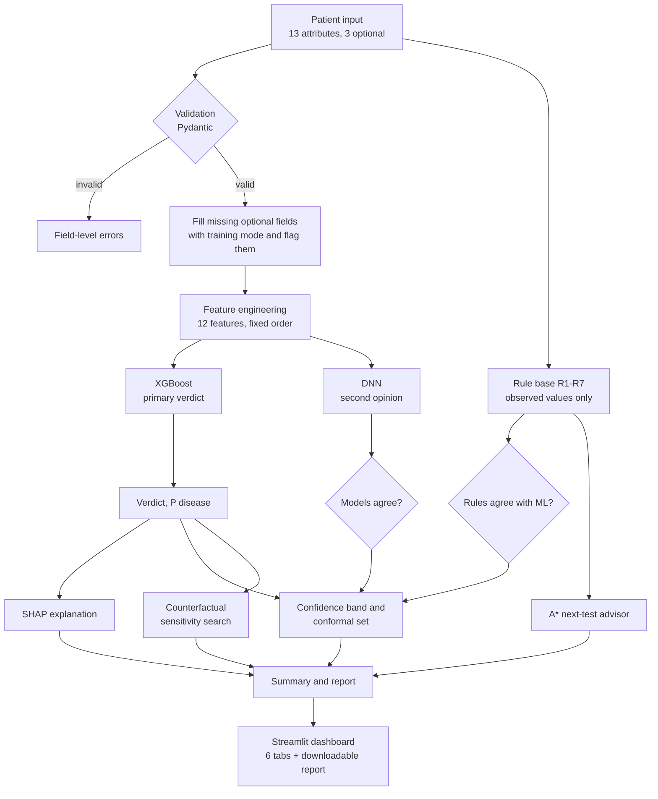

# SymbioForge CDSS

**Cardiovascular Clinical Decision Support System.** A lab-practical prototype (CELBC710, Tasks 9-10) that takes a patient's clinical attributes and returns a risk estimate together with the evidence needed to judge whether to trust it.

> **Decision support only, not a diagnosis.** Trained on a public research dataset; not clinically validated.

## How it feels to use

1. **Chat intake.** SymbioForge asks short questions in plain language (about you, chest symptoms, check-up numbers, heart tests, optional specialised tests). Every field has a "?" tooltip explaining what it is and why it matters. You can also describe symptoms in your own words and it pre-fills what it understood.
2. **Overview, not just a label.** You get a risk pattern (lower / intermediate / higher) with an estimated chance, how sure the model is, which parts of your profile moved the estimate, each of your measurements against reference ranges, what-if curves, ranked next tests, and questions to take to a doctor.
3. **Ask follow-ups.** A built-in chat answers questions from your own analysis ("Why is my result like this?", "What does ECG mean?").
4. **"How it works" view** (for reviewers) shows the orchestration of the eight Task 1-8 workflows with a live trace, model internals, evaluation, EDA, limitations and the decision log.

## What it does

For one patient at a time, the system returns:

| Output | How |
|---|---|
| Risk estimate and verdict (present / absent) | XGBoost on 12 engineered features |
| Second opinion | Deep neural network; the UI flags when the two models disagree |
| Rule-base cross-check | Task 2 expert rules R1-R7, evaluated three-valued (fired / not fired / unknown), never on guessed values |
| Per-patient explanation | Exact TreeSHAP contributions plus a plain-language summary |
| Confidence | Trust band from validation accuracy, plus a conformal prediction set (90%) |
| Reliability warnings | Missing optional tests, out-of-range age, model or rule disagreement |
| "What would flip it" | Model-sensitivity search over plausible changes (not clinical advice) |
| Next-test advice | A* search (Task 3) over the missing tests, ranked by whether they could change the verdict |
| Depth analysis | Risk broken into domains (symptoms, stress test, cholesterol, overall profile), measurement cards, what-if curves, doctor questions |
| Report | Print-ready HTML (print to PDF) |

## Technology

| Layer | Tools |
|---|---|
| Language | Python 3.11+ |
| UI / dashboard | Streamlit, Plotly |
| Models | XGBoost (primary, saved as portable JSON), PyTorch-trained DNN served in plain NumPy |
| Data / ML | pandas, NumPy, scikit-learn (CV, metrics, scaling) |
| Validation | Pydantic v2 (field-level errors) |
| Explainability | XGBoost native TreeSHAP, conformal prediction, counterfactual search |
| Reasoning | Rule-based forward chaining, A* state-space search |
| Evaluation | pytest (20 tests), matplotlib |
| Cost | Zero: all open source, runs locally |

## Flowchart



## Run it (PowerShell)

From the project folder:

```powershell
cd C:\Users\aarya\OneDrive\Desktop\CODING\SymbioForge
```

**1. Create and activate a virtual environment (optional but recommended)**
```powershell
python -m venv .venv
.\.venv\Scripts\Activate.ps1
```
If activation is blocked: `Set-ExecutionPolicy -Scope Process -ExecutionPolicy Bypass`

**2. Install runtime dependencies**
```powershell
pip install -r requirements.txt
```

**3. Start the dashboard**
```powershell
streamlit run app.py
```
Open http://localhost:8501. Pick a scripted case under "Load demo patient", or enter your own values.

The trained models (`artifacts/`) and evaluation outputs (`reports/`) are committed, so no training is needed to run the app.

## Verify and rebuild (optional)

```powershell
pip install -r requirements-train.txt   # adds torch, matplotlib, pytest
python -m pytest -q                     # 20 tests
python train.py                         # re-clean, split, train XGBoost + DNN, calibrate trust bands (several minutes)
python eda.py                           # EDA and correlation report
python evaluate.py                      # test-set metrics, calibration, fairness, ablation, robustness, latency
python build_docs.py                    # regenerate docs/PROJECT_REPORT.md from the results
```
Run the rebuild scripts in that order. `train.py` overwrites `artifacts/`, `data/Task4*` and `data/Task5*`.

## Project layout

| Path | Purpose |
|---|---|
| `app.py` | Streamlit entry point (view switch) |
| `cdss/features.py` | Feature formulas (single source of truth) and Task 4 cleaning |
| `cdss/schemas.py` | Input validation |
| `cdss/rules.py` | Task 2 rule base, three-valued logic |
| `cdss/advisor.py` | Task 3 A* next-test planner |
| `cdss/engine.py` | Inference pipeline, SHAP, counterfactuals, confidence, summary |
| `cdss/orchestrator.py` | Runs the workflows and builds the patient overview |
| `cdss/glossary.py` | Plain-language meaning of each input and reference ranges |
| `cdss/chat.py` | Rule-based chat: intro parsing and follow-up answers |
| `ui/` | Streamlit views: `assess.py` (user flow), `mechanics.py` (How it works), `style.py` |
| `cdss/report.py` | HTML report generator |
| `train.py`, `eda.py`, `evaluate.py`, `build_docs.py` | Reproducible build and evaluation scripts |
| `data/` | Input dataset, cleaned dataset, feature matrix |
| `artifacts/` | `xgb.json`, `dnn.json` (served), `dnn.pt` (training checkpoint), `meta.json` |
| `reports/` | Evaluation JSON, EDA report, model comparison, figures, sample report |
| `docs/` | `PROJECT_REPORT.md` (full summary), `DELIVERABLES.md` (task checklist) |
| `SPEC.md`, `ARCHITECTURE.md`, `PLAN.md`, `context.md` | Requirements, design and decision log, plan, prior-task reference |

## Deploy

Push to GitHub, then create an app on Streamlit Community Cloud with main file `app.py` (Python 3.11+, `requirements.txt` only; no secrets, nothing stored).

## Limitations

Historical data from four hospitals; small test set (138 patients), so model differences are within noise; no external validation; counterfactuals are model sensitivity, not treatment effects. See `docs/PROJECT_REPORT.md` for the full responsible-AI discussion.
