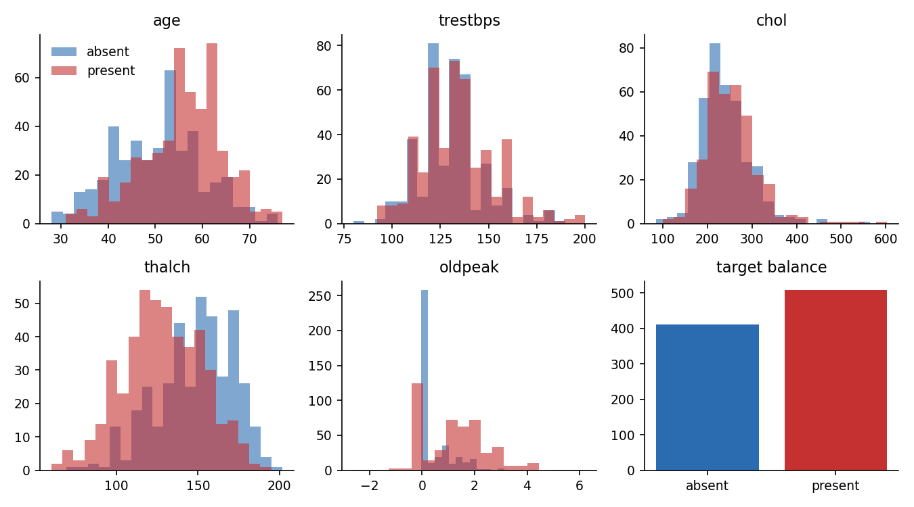
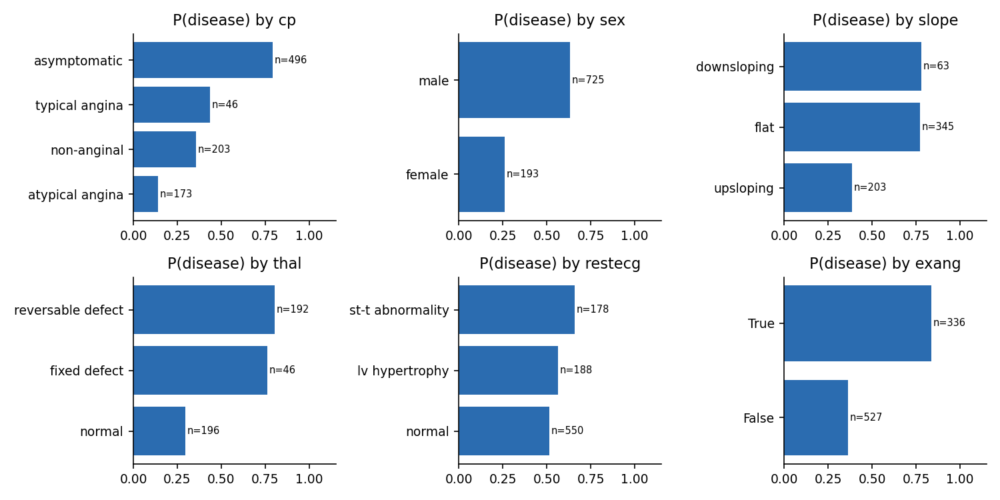
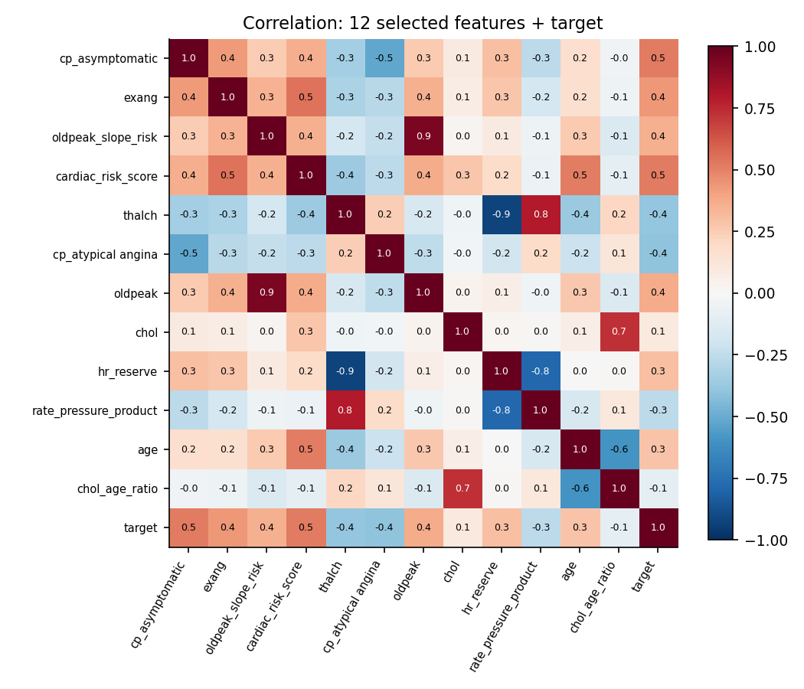

# EDA and Data Quality Report (Tasks 4-5)

Generated by `eda.py`. Raw file `data/heart_dataset.csv`; cleaned per context.md section 5.

## 1. Data quality
- Rows: 920 raw -> 918 after dropping 2 exact duplicate row(s) (id ignored).
- Columns: 16 raw; target `num` (0-4) binarised to `target` (present if num > 0); prevalence 55.3%.
- `chol == 0` and `trestbps == 0` are disguised missing values, converted to NaN before imputation.

| index | missing '?' / NaN | disguised zeros | % missing after zero->NaN |
|---|---|---|---|
| trestbps | 59 | 1 | 6.500 |
| chol | 30 | 172 | 22.000 |
| fbs | 90 | 0 | 9.800 |
| restecg | 2 | 0 | 0.200 |
| thalch | 55 | 0 | 6.000 |
| exang | 55 | 0 | 6.000 |
| oldpeak | 62 | 0 | 6.700 |
| slope | 309 | 0 | 33.600 |
| ca | 611 | 0 | 66.400 |
| thal | 486 | 0 | 52.800 |

### Missingness (%) by site
| dataset | trestbps | chol | thalch | oldpeak | fbs | exang | slope | ca | thal |
|---|---|---|---|---|---|---|---|---|---|
| Cleveland | 0.000 | 0.000 | 0.000 | 0.000 | 0.000 | 0.000 | 0.000 | 2.000 | 1.000 |
| Hungary | 0.000 | 8.000 | 0.000 | 0.000 | 3.000 | 0.000 | 64.000 | 99.000 | 90.000 |
| Switzerland | 2.000 | 100.000 | 1.000 | 5.000 | 61.000 | 1.000 | 14.000 | 96.000 | 42.000 |
| VA Long Beach | 29.000 | 28.000 | 27.000 | 28.000 | 4.000 | 27.000 | 51.000 | 99.000 | 83.000 |

### Sample size and disease prevalence by site
| dataset | n | prevalence |
|---|---|---|
| Cleveland | 304 | 0.457 |
| Hungary | 292 | 0.363 |
| Switzerland | 123 | 0.935 |
| VA Long Beach | 199 | 0.744 |

**Finding.** Missingness and prevalence both depend heavily on the site (e.g. Switzerland has almost no observed `chol` and the highest prevalence). Any value used to fill gaps must therefore not be a single constant, or the model can learn the site as a proxy for disease (see ARCHITECTURE D7).

## 2. Statistical summary (observed values only)
| index | count | mean | std | min | 25% | 50% | 75% | max | skew |
|---|---|---|---|---|---|---|---|---|---|
| age | 918.000 | 53.510 | 9.430 | 28.000 | 47.000 | 54.000 | 60.000 | 77.000 | -0.200 |
| trestbps | 858.000 | 132.290 | 18.530 | 80.000 | 120.000 | 130.000 | 140.000 | 200.000 | 0.630 |
| chol | 717.000 | 246.870 | 58.560 | 85.000 | 210.000 | 240.000 | 277.000 | 603.000 | 1.310 |
| thalch | 863.000 | 137.540 | 25.940 | 60.000 | 120.000 | 140.000 | 157.000 | 202.000 | -0.210 |
| oldpeak | 856.000 | 0.880 | 1.090 | -2.600 | 0.000 | 0.500 | 1.500 | 6.200 | 1.040 |

### Categorical counts
| column | levels |
|---|---|
| sex | male: 725; female: 193 |
| cp | asymptomatic: 496; non-anginal: 203; atypical angina: 173; typical angina: 46 |
| restecg | normal: 550; lv hypertrophy: 188; st-t abnormality: 178; <NA>: 2 |
| slope | flat: 345; <NA>: 307; upsloping: 203; downsloping: 63 |
| thal | <NA>: 484; normal: 196; reversable defect: 192; fixed defect: 46 |
| fbs | False: 690; True: 138; nan: 90 |
| exang | False: 527; True: 336; nan: 55 |
| ca | nan: 609; 0.0: 181; 1.0: 67; 2.0: 41; 3.0: 20 |

## 3. Outliers (IQR rule)
| column | lower fence | upper fence | outliers |
|---|---|---|---|
| age | 27.500 | 79.500 | 0 |
| trestbps | 90.000 | 170.000 | 27 |
| chol | 109.500 | 377.500 | 23 |
| thalch | 64.500 | 212.500 | 2 |
| oldpeak | -2.200 | 3.800 | 16 |

Policy (context.md section 5 step 7): outliers are **retained**; they are clinically plausible extremes, not entry errors.

## 4. Distributions and target relationships

**Findings.** Asymptomatic chest pain is by far the strongest single marker of disease (consistent with Tasks 1, 2 and 8). Males, flat/downsloping ST slope, exercise angina and abnormal `thal` all show higher disease rates. The classes are roughly balanced, so accuracy is a usable headline metric.

## 5. Correlation and feature importance (Task 5)

### Correlation with target
| index | pearson r |
|---|---|
| cardiac_risk_score | 0.519 |
| cp_asymptomatic | 0.517 |
| exang | 0.432 |
| cp_atypical angina | -0.402 |
| thalch | -0.385 |
| oldpeak | 0.373 |
| oldpeak_slope_risk | 0.356 |
| hr_reserve | 0.302 |
| age | 0.282 |
| rate_pressure_product | -0.261 |
| chol | 0.100 |
| chol_age_ratio | -0.094 |

### Highly correlated feature pairs (|r| >= 0.7)
| feature A | feature B | r |
|---|---|---|
| oldpeak_slope_risk | oldpeak | 0.944 |
| thalch | hr_reserve | -0.929 |
| thalch | rate_pressure_product | 0.790 |
| chol | chol_age_ratio | 0.733 |
| hr_reserve | rate_pressure_product | -0.787 |

### Mutual information with target (train split)
| index | mutual information |
|---|---|
| cardiac_risk_score | 0.179 |
| cp_asymptomatic | 0.143 |
| oldpeak | 0.113 |
| age | 0.101 |
| exang | 0.092 |
| oldpeak_slope_risk | 0.079 |
| thalch | 0.079 |
| hr_reserve | 0.071 |
| cp_atypical angina | 0.062 |
| rate_pressure_product | 0.053 |
| chol_age_ratio | 0.021 |
| chol | 0.009 |

**Findings.** Derived features (`hr_reserve`, `rate_pressure_product`, `oldpeak_slope_risk`) are strongly related to their parents (`thalch`, `age`, `oldpeak`), so there is redundancy; tree models and the regularised DNN tolerate this, but linear coefficients should not be interpreted individually. Final model uses the 12 features fixed in context.md section 6.

## 6. Caveats
- Disease prevalence by site: {'Cleveland': 0.46, 'Hungary': 0.36, 'Switzerland': 0.93, 'VA Long Beach': 0.74}. Site is not a model input, but it confounds every column that is missing selectively.
- Female patients are a minority; subgroup results have wide uncertainty (see evaluation fairness table).
- Data are historical research data, not representative of current clinical populations.
